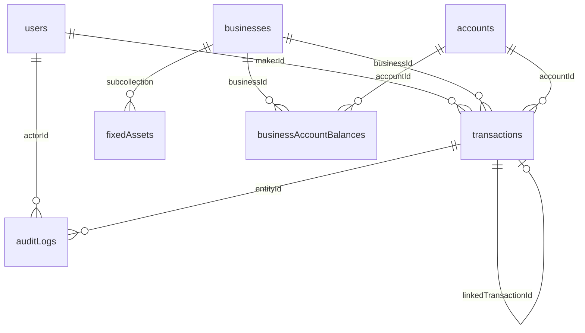

# Database schema

Golden 7 uses **Cloud Firestore** as the primary datastore and **Firebase Storage** for transaction attachments. TypeScript shapes live in [`lib/types.ts`](./lib/types.ts); read/write mapping is in [`lib/firebase/firestore.ts`](./lib/firebase/firestore.ts) and [`lib/firebase/summaries.ts`](./lib/firebase/summaries.ts). Security is enforced by [`firestore.rules`](./firestore.rules) and [`storage.rules`](./storage.rules).

Currency is always **MMK**. Dates on transactions and fixed assets are `YYYY-MM-DD` strings. Timestamps (`createdAt`, `updatedAt`, etc.) are Firestore `Timestamp` values.

Only **approved** transactions change balances and summary rollups. Pending rows only bump pending counters.

---

## Collection overview

```text
users/{uid}
businesses/{businessId}
  └── fixedAssets/{assetId}
accounts/{accountId}
businessAccountBalances/{businessId}_{accountId}
transactions/{txId}
auditLogs/{id}
counters/txn-{DDMMYY}
summaries/group
  └── months/{YYYY-MM}
businessSummaries/{businessId}
  └── months/{YYYY-MM}
accountSummaries/{accountId}
  └── months/{YYYY-MM}

Storage: transactions/{txId}/{fileName}
```



---

## `users/{uid}`

App profile for a Firebase Auth user. Document ID = Auth UID.

| Field | Type | Notes |
| --- | --- | --- |
| `email` | string | Required |
| `displayName` | string | Required |
| `role` | `"admin" \| "maker" \| "checker" \| "approver" \| null` | `null` until an admin/checker assigns a role |
| `mustChangePassword` | boolean | Set on API-created users; cleared after first password change |
| `createdAt` | timestamp | |

Self-create on first login is allowed with `role: null`. Role/display name updates are restricted in rules; password-flag clear is self-only.

---

## `businesses/{businessId}`

Operating units (plus an optional system retained-earnings unit). Soft-delete via `status`; hard delete is forbidden in rules.

| Field | Type | Notes |
| --- | --- | --- |
| `name` | string | |
| `code` | string | Uppercased on write |
| `status` | `"active" \| "inactive"` | |
| `notes` | string | Optional |
| `isSystem` | boolean | Optional; system/RE units are hidden from normal lists when `true` or `code === "RE"` |
| `totalCapital` | number | Sum of opening holdings across accounts |
| `fixedAssetExpense` | number | Denormalized sum of `fixedAssets.amount` |
| `totalSaleVolume` | number | Optional manual KPI |
| `operationExpense` | number | Optional manual KPI |
| `totalProfit` | number | Optional manual KPI |
| `createdAt` | timestamp | |
| `updatedAt` | timestamp | |

### `businesses/{businessId}/fixedAssets/{assetId}`

| Field | Type | Notes |
| --- | --- | --- |
| `name` | string | |
| `department` | string | Optional |
| `amount` | number | Must be `> 0` |
| `date` | string | `YYYY-MM-DD` |
| `notes` | string | Optional |
| `createdAt` | timestamp | |
| `updatedAt` | timestamp | |

Creating/updating/deleting an asset recomputes parent `fixedAssetExpense`.

---

## `accounts/{accountId}`

Shared group bank or cash accounts. Soft-delete via `status`.

| Field | Type | Notes |
| --- | --- | --- |
| `type` | `"bank" \| "cash"` | |
| `name` | string | |
| `bankName` | string | Optional (bank) |
| `accountNumber` | string | Optional |
| `bankBranch` | string | Optional |
| `bankAddress` | string | Optional |
| `currency` | `"MMK"` | Fixed |
| `openingBalance` | number | Group opening; increases when businesses allocate capital |
| `currentBalance` | number | Starts at opening; updated only on **approve** (and capital adjustments) |
| `pendingCount` | number | Pending txs touching this account |
| `approvedCount` | number | Approved txs touching this account |
| `status` | `"active" \| "inactive"` | |
| `createdAt` | timestamp | |
| `updatedAt` | timestamp | |

On create, `currentBalance` must equal `openingBalance`. Approvers may update only settle fields (`currentBalance`, `pendingCount`, `approvedCount`, `updatedAt`). Makers may bump `pendingCount` + `updatedAt` when creating pending txs.

---

## `businessAccountBalances/{businessId}_{accountId}`

Per-business money held inside a shared account. Document ID is `${businessId}_${accountId}`.

| Field | Type | Notes |
| --- | --- | --- |
| `businessId` | string | |
| `accountId` | string | |
| `openingBalance` | number | Capital allocated to this business in this account |
| `currentBalance` | number | Opening ± approved income/expense/transfer deltas |
| `createdAt` | timestamp | |
| `updatedAt` | timestamp | |

Created when a business is given opening capital, or lazily on first approve settle if missing (`openingBalance: 0`).

Invariant (conceptually): for each account, sum of holding `currentBalance` values should track the account’s approved movements relative to openings. Account `currentBalance` is the shared wallet total.

---

## `transactions/{txId}`

Income, expense, or one leg of an internal transfer. Never hard-deleted in rules.

| Field | Type | Notes |
| --- | --- | --- |
| `displayId` | string | Human id, e.g. `TXN-281026-3` (from daily counter) |
| `businessId` | string | |
| `accountId` | string | |
| `direction` | `"income" \| "expense"` | |
| `category` | string | See category enums below |
| `amount` | number | Must be `> 0` |
| `date` | string | `YYYY-MM-DD` (business date; drives month rollups and display id) |
| `description` | string | |
| `status` | `"pending" \| "approved" \| "rejected"` | Created as `pending` only. Legacy `draft` is read as `pending` |
| `makerId` | string | Auth UID; immutable after create |
| `makerName` | string | Optional denormalized |
| `approverId` | string | Set on approve/reject |
| `approverName` | string | Optional |
| `checkerId` / `checkerName` | string | **Deprecated**; mapped to approver fields on read |
| `rejectionReason` | string | On reject |
| `transferGroupId` | string | Shared by both legs of an internal transfer |
| `linkedTransactionId` | string | Id of the opposite transfer leg |
| `attachments` | array | See attachment object below (max 5) |
| `createdAt` | timestamp | |
| `updatedAt` | timestamp | |
| `submittedAt` | timestamp | Optional |
| `approvedAt` | timestamp | On approve |
| `rejectedAt` | timestamp | On reject |

### Attachment object (embedded)

| Field | Type | Notes |
| --- | --- | --- |
| `path` | string | Storage path |
| `url` | string | Download URL |
| `name` | string | Original filename |
| `contentType` | string | `image/jpeg`, `image/png`, or `image/webp` |
| `size` | number | Bytes (≤ 5 MiB stored) |
| `uploadedAt` | timestamp | |
| `uploadedBy` | string | UID |

### Categories

**Income:** `sales_revenue`, `other_business_income`, `transfers_received`, `other_incoming`

**Expense:** `operating_expenses`, `purchases`, `salaries`, `utilities`, `transportation`, `other_business_expenses`, `transfers_sent`

Internal transfers create **two** pending documents (expense `transfers_sent` + income `transfers_received`) with the same `transferGroupId` and mutual `linkedTransactionId`. Approve/reject applies to both legs together.

### Balance effect on approve

| Direction | Account / holding `currentBalance` |
| --- | --- |
| income | `+ amount` |
| expense | `− amount` |

Pending create/reject adjusts `pendingCount` only (no balance change).

---

## `auditLogs/{id}`

Append-only history. Updates/deletes forbidden in rules.

| Field | Type | Notes |
| --- | --- | --- |
| `action` | `"created" \| "updated" \| "approved" \| "rejected" \| "deleted"` | Rules allow create for the first four; `deleted` reserved |
| `entityType` | `"transaction" \| "user"` | |
| `entityId` | string | |
| `actorId` | string | Must equal auth UID on create |
| `actorName` | string | |
| `previousStatus` | string | Optional (transactions) |
| `newStatus` | string | Optional |
| `changes` | `{ field, from, to }[]` | Optional field-level diffs |
| `rejectionReason` | string | Optional |
| `businessId`, `accountId`, `amount`, `direction`, `description` | mixed | Optional transaction snapshot |
| `transferGroupId`, `linkedTransactionId` | string | Optional |
| `createdAt` | timestamp | |

---

## `counters/txn-{DDMMYY}`

Daily sequence for `displayId` allocation.

| Field | Type | Notes |
| --- | --- | --- |
| `seq` | number | Last allocated sequence for that calendar day |

Key is derived from transaction `date` as `txn-` + `DDMMYY` (e.g. date `2026-10-28` → `txn-281026`). Display ids look like `TXN-281026-{n}`.

---

## Summary rollups (denormalized)

Updated inside the same Firestore transaction as approve (and adjusted for pending count on create/reject). Rebuild from all transactions with `npm run backfill:summaries`.

### Shared bucket fields (`IncomeExpenseBucket`)

| Field | Meaning |
| --- | --- |
| `income` | Approved external income (excludes transfer categories) |
| `expense` | Approved external expense (excludes transfer categories) |
| `transferIn` | Approved `transfers_received` (or legacy transfer income) |
| `transferOut` | Approved `transfers_sent` (or legacy transfer expense) |

External P&L net = `income - expense`. Cash-flow net including transfers = `income + transferIn - expense - transferOut`.

### `summaries/group`

| Field | Type | Notes |
| --- | --- | --- |
| bucket fields | number | Lifetime group totals |
| `pendingCount` | number | Group-wide pending txs |
| `updatedAt` | timestamp | |

### `summaries/group/months/{YYYY-MM}`

| Field | Type | Notes |
| --- | --- | --- |
| bucket fields | number | That month |
| `byBusiness` | map of id → bucket | Per-business breakdown |
| `byAccount` | map of id → bucket | Per-account breakdown |

Document id is the month key from the transaction date (`date.slice(0, 7)`).

### `businessSummaries/{businessId}` and `…/months/{YYYY-MM}`

Lifetime + optional `updatedAt` on the parent. Month docs are bucket-only.

### `accountSummaries/{accountId}` and `…/months/{YYYY-MM}`

Same shape as business summaries.

---

## Firebase Storage

Path: `transactions/{txId}/{fileName}`

- Read: any signed-in user  
- Write/delete: `admin` or `maker`  
- Max size: 5 MiB  
- Content types: `image/jpeg`, `image/png`, `image/webp`

Metadata for each file is also stored on the transaction document under `attachments`.

---

## Indexes

Composite indexes are declared in [`firestore.indexes.json`](./firestore.indexes.json), mainly for:

- `transactions` filtered by `status`, `makerId`, `businessId`, `accountId`, `direction`, `category`, ordered by `date` / `createdAt`
- `auditLogs` by `action` / `entityType` + `createdAt`

Deploy with `firebase deploy --only firestore:indexes`.

---

## Access summary (rules)

| Collection | Read | Write highlights |
| --- | --- | --- |
| `users` | Self, admin, checker | Self-create (`role: null`); admin role/name; self clear `mustChangePassword` |
| `businesses` (+ `fixedAssets`) | Signed-in | Admin create/update; fixed assets admin CRUD |
| `accounts` | Signed-in | Admin create/update; settle keys for approver/admin; maker pending count |
| `businessAccountBalances` | Signed-in | Admin or settle roles |
| `transactions` | Finance roles, or own as maker | Maker/admin create pending; maker edit own pending; approver approve/reject |
| `auditLogs` | Finance roles | Create only (actor = self) |
| `counters` | Maker/admin | Maker/admin |
| summaries | Signed-in | Admin/settle (makers may touch group `pendingCount`) |

“Finance roles” = `admin`, `checker`, `approver`. Settle = `admin`, `approver`.

---

## Source of truth

| Concern | Location |
| --- | --- |
| Domain types & enums | `lib/types.ts` |
| CRUD & balance/transfer logic | `lib/firebase/firestore.ts` |
| Summary paths & approve writers | `lib/firebase/summaries.ts`, `lib/summaries.ts` |
| Bucket math | `lib/summaries.ts` |
| Rules | `firestore.rules`, `storage.rules` |
| Indexes | `firestore.indexes.json` |
| Summary rebuild | `scripts/backfill-summaries.ts` |
| Destructive purge (admin API) | `app/api/settings/purge-data/route.ts` |
